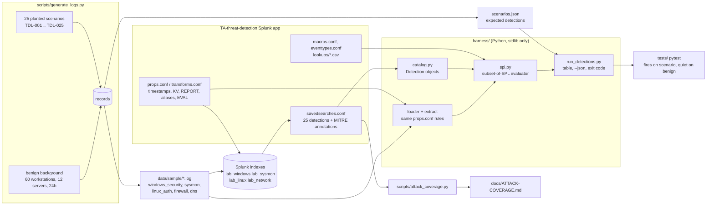

# Splunk Threat Detection Lab

A deployable Splunk add-on with 25 ATT&CK-mapped scheduled detections, plus a Python harness that executes the exact SPL from `savedsearches.conf` over synthetic logs so every detection is unit-tested without a Splunk instance.


## Why this project exists

A SOC's detection content is only as good as its last test. Rules get written against a mental model of the data, deployed, and then quietly stop working when a field name changes or a threshold drifts. This repository treats detections like code: each search is a conf stanza with ATT&CK annotations, each has a planted attack scenario that must trigger it, each has a benign baseline it must stay quiet on, and `pytest` fails if either side breaks. The app installs into Splunk unchanged; the harness exists so the same searches can be validated in CI, on a laptop, or during a code review.

## What it demonstrates

- Writing production-shape Splunk content: `savedsearches.conf` with cron schedules, suppression, severity and Enterprise Security correlation-search annotations; `props.conf`/`transforms.conf` field extraction for five log formats; CIM-style field aliases; macros for data-source abstraction and allowlists; CSV lookups with exact and CIDR matching; eventtypes and tags.
- Detection engineering across the kill chain: brute force and spraying, impossible travel, admin-account persistence, RDP and SMB lateral movement, encoded PowerShell, Office macro chains, LSASS access, log clearing, DNS tunnelling, beaconing, rare ports, threat-intel matching, exfiltration baselining, Linux SSH and sudo abuse.
- Statistical and correlation techniques in SPL: `bin` + `stats` thresholds, `streamstats` with `time_window` for ordered correlation, `eventstats` for per-host baselines, coefficient-of-variation beacon analysis, `rare` for hunting.
- Building a test oracle: a subset-of-SPL interpreter (search, eval, where, stats, eventstats, streamstats, rare, bin, sort, lookup, rex, dedup, table) and a props.conf-driven extractor so the harness sees the same fields Splunk would.
- Synthetic data generation with planted scenarios: a 24-hour, 60-workstation, 12-server environment with realistic benign noise, and one labelled scenario per detection.
- Documentation an analyst can use: one page per detection with tuning notes and response steps, a generated ATT&CK coverage matrix, and install and tuning guides.

### Security+ (SY0-701) and framework mapping

| Feature | Security+ domain | MITRE ATT&CK | NIST CSF |
|---|---|---|---|
| 25 scheduled alerts with severity, suppression and ES annotations | 4.0 Security Operations: 4.4 security alerting and monitoring; SIEM | all 32 techniques in `docs/ATTACK-COVERAGE.md` | DE.CM, DE.AE |
| Brute force, spraying, SSH success-after-failures (TDL-001, 002, 020, 021) | 2.4 indicators of malicious activity (password attacks); 4.6 identity and access | T1110.001, T1110.003, T1078 | DE.CM-1 |
| Impossible travel with CIDR geolocation lookup (TDL-003) | 4.4 monitoring; 4.6 access controls | T1078, T1078.004 | DE.AE-2 |
| New admin account correlation on Windows and Linux (TDL-004, 022) | 4.6 privileged access, account provisioning | T1136.001, T1098, T1548.003 | DE.CM-3 |
| RDP and SMB lateral movement (TDL-005, 006) | 2.4 indicators; 4.4 monitoring | T1021.001, T1021.002 | DE.AE-1 |
| Encoded PowerShell, Office spawning shells, LOLBin DNS (TDL-007, 012, 025) | 2.4 malware and script indicators; 4.5 endpoint hardening | T1059.001, T1027.010, T1566.001, T1204.002, T1218 | DE.CM-4 |
| Scheduled task, Startup folder, unsigned DLL persistence (TDL-008, 023, 024) | 2.4 persistence indicators | T1053.005, T1547.001, T1574.001/002 | DE.CM-7 |
| LSASS access and event-log clearing (TDL-014, 015) | 2.4 credential dumping, anti-forensics | T1003.001, T1070.001 | DE.CM-4 |
| DNS tunnelling, subdomain cardinality, beaconing, rare ports, threat intel, exfil baseline (TDL-009, 010, 011, 016, 017, 018) | 4.4 network monitoring; 3.2 secure network design; threat intelligence feeds | T1071.001/004, T1048, T1041, T1571, T1095, T1105 | DE.AE-1, DE.CM-1 |
| Per-detection response steps, suppression, tuning guide | 4.8 incident response; 4.9 investigation data sources | - | RS.AN, RS.MI |
| Synthetic data, harness and pytest gate | 4.1 secure baselines; 5.x change management | - | ID.RA, PR.IP |

## Architecture



Two consumers read the same app files. Splunk parses `props.conf` at search time and runs the saved searches on its scheduler. The harness parses the same `props.conf` with `harness/extract.py`, loads the same CSV lookups and macros, and runs the same `search =` strings through `harness/spl.py`. Nothing is duplicated: there is no Python re-implementation of any detection.

## Quickstart

```bash
git clone https://github.com/brooklynkid707-cmd/splunk-threat-detection-lab
cd splunk-threat-detection-lab
pip install -r requirements.txt            # pytest only; runtime is standard library

python -m harness.run_detections           # run all 25 detections over data/sample
python -m pytest -q                        # 106 tests
```

Other entry points:

```bash
python scripts/generate_logs.py --out data/sample --seed 42          # regenerate the sample set
python scripts/generate_logs.py --out /tmp/benign --scenarios none   # benign-only baseline
python scripts/generate_logs.py --out /tmp/x --scenarios TDL-007,beacon
python scripts/generate_logs.py --list-scenarios
python -m harness.run_detections --data /tmp/benign --expect none    # must be quiet
python -m harness.run_detections --only TDL-011,TDL-017 --json results.json
python scripts/attack_coverage.py                                    # regenerate docs/ATTACK-COVERAGE.md
make help
```

To install the app in Splunk, see `docs/INSTALL.md`.

## Sample output

`python -m harness.run_detections --data data/sample` over the committed sample set:

```
Detections over 10264 events from data/sample

ID       Status  Sev       Rows  Detection                                                  Entities
----------------------------------------------------------------------------------------------------
TDL-001  PASS    high         1  Windows Brute Force - Many Failures From One Source        src_ip=203.0.113.45
TDL-002  PASS    high         1  Windows Password Spraying - One Source, Many Accounts      src_ip=198.51.100.23
TDL-003  PASS    high         2  Impossible Travel - Same User, Two Countries Within One... user=mchen src_ip=192.0.2.55 dest=SRV-VPN-01
                                                                                            user=mchen src_ip=203.0.113.112 dest=SRV-VPN-01
TDL-004  PASS    critical     1  New Account Created And Added To Administrators            target_user=backupadm dest=DC-01
TDL-005  PASS    high         1  Lateral Movement - RDP To Multiple Hosts By One User       user=mchen
TDL-006  PASS    high         1  Lateral Movement - SMB Fan-Out From One Host               src_ip=10.20.1.55 host=WS-FIN-07
TDL-007  PASS    high         2  PowerShell Encoded Command                                 user=onelson host=WS-HR-03
                                                                                            user=CORP\onelson host=WS-HR-03
TDL-008  PASS    medium       2  Scheduled Task Created By Interactive User                 user=CORP\lwright host=WS-FIN-07 task=schtasks.exe /create /sc minute /mo 15 /tn "OneDriveSync" /tr "C:\Users\Public\sync.exe" /f
                                                                                            user=lwright host=WS-FIN-07 task=\OneDriveSync
TDL-009  PASS    high         1  DNS Tunneling - Abnormally Long Query Names                src_ip=10.20.4.53 base_domain=example.net
TDL-010  PASS    high         1  DNS - Excessive Unique Subdomains For One Base Domain      src_ip=10.20.4.57 base_domain=example.org
TDL-011  PASS    high         1  Beaconing - Regular Interval Outbound Connections          src_ip=10.20.2.52 dest_ip=203.0.113.66
TDL-012  PASS    critical     2  Office Application Spawning Shell Or Script Host           user=CORP\onelson host=WS-HR-03 process=C:\Windows\System32\WindowsPowerShell\v1.0\powershell.exe
                                                                                            user=CORP\icook host=WS-FIN-02 process=C:\Windows\System32\cmd.exe
TDL-013  PASS    low          7  Rare Parent-Child Process Pair                             parent_name=cmd.exe child_name=runas.exe
                                                                                            parent_name=cmd.exe child_name=schtasks.exe
                                                                                            parent_name=cmd.exe child_name=wevtutil.exe
                                                                                            (+4 more)
TDL-014  PASS    critical     1  LSASS Memory Access By Non-Allowlisted Process             user=CORP\lwright host=WS-FIN-07 SourceImage=C:\Windows\Temp\pd.exe
TDL-015  PASS    critical     2  Windows Event Log Cleared                                  user=CORP\lwright host=WS-FIN-07
                                                                                            user=lwright host=WS-FIN-07
TDL-016  PASS    medium       1  Outbound Connection On Rare Destination Port               src_ip=10.20.4.50 dest_port=4444
TDL-017  PASS    critical     2  Connection To Known-Bad IP (Threat Intel Match)            src_ip=10.20.2.52 dest_ip=203.0.113.66
                                                                                            src_ip=10.20.3.56 dest_ip=198.51.100.251
TDL-018  PASS    high         1  Data Exfiltration - Outbound Volume Spike Per Host         src_ip=10.20.2.57
TDL-019  PASS    medium       1  Privilege Escalation Attempt Via runas To Admin Account    user=CORP\lwright host=WS-FIN-07
TDL-020  PASS    medium       1  Linux SSH Brute Force                                      src_ip=192.0.2.77 host=srv-bastion-01
TDL-021  PASS    critical     1  Linux SSH Success After Repeated Failures                  user=deploy src_ip=203.0.113.90 host=srv-web-01
TDL-022  PASS    high         1  Linux New User Added To sudo/wheel Group                   target_user=svcmon
TDL-023  PASS    medium       1  Unsigned DLL Loaded From User-Writable Path                host=WS-FIN-07 ImageLoaded=C:\Users\lwright\AppData\Local\Temp\version.dll
TDL-024  PASS    medium       1  File Dropped In Startup Folder                             user=CORP\nhill host=WS-ENG-05 process=C:\Windows\System32\WindowsPowerShell\v1.0\powershell.exe
TDL-025  PASS    medium       1  DNS Query From Scripting Or LOLBin Process                 host=WS-HR-03 process=C:\Windows\System32\WindowsPowerShell\v1.0\powershell.exe

25/25 detections fired, 37 result rows, 15.1s search time
All expected detections fired.
```

The extra rows are real overlaps, not noise: the beacon in TDL-011 talks to an address on the lab threat feed so TDL-017 catches it too; the Word-to-PowerShell chain planted for TDL-007 is also an Office-spawns-shell event for TDL-012; TDL-003 reports both the US-to-Brazil hop and the Brazil-to-US hop 22 minutes later; the 4688 and Sysmon 1 views of the same process give TDL-007, TDL-008 and TDL-015 one row per source. TDL-013 is a hunting list by design and surfaces the other scenarios' rare process pairs.

The same searches over benign-only data (`--scenarios none`) produce zero rows for all 25. The test suite checks this at seed 42; I also ran seeds 1, 7 and 2026 by hand with `--expect none` and all were quiet.

`python -m pytest -q`:

```
........................................................................ [ 67%]
..................................                                       [100%]
106 passed in 48.10s
```

`python scripts/generate_logs.py --out data/sample`:

```
wrote 10264 lines to data/sample/ (seed=42, 24h, 25 scenarios)
  windows_security.log     1065 lines
  sysmon.log               2366 lines
  linux_auth.log            419 lines
  firewall.log             2854 lines
  dns.log                  3560 lines
```

## Project layout

```
splunk-threat-detection-lab/
├── TA-threat-detection/              # the Splunk app (copy into $SPLUNK_HOME/etc/apps/)
│   ├── default/
│   │   ├── savedsearches.conf        # 25 detections TDL-001..TDL-025 with ATT&CK annotations
│   │   ├── props.conf                # 5 sourcetypes: timestamps, KV, REPORT, FIELDALIAS, EVAL
│   │   ├── transforms.conf           # delimited/regex extractions + lookup definitions
│   │   ├── macros.conf               # data-source macros, allowlists, bytes_to_mb(1)
│   │   ├── eventtypes.conf, tags.conf# CIM-style event classes
│   │   ├── indexes.conf, inputs.conf # lab indexes and (disabled) file monitors
│   │   ├── app.conf
│   │   └── data/ui/                  # SOC Overview dashboard + nav
│   ├── lookups/                      # known_bad_ips.csv, known_bad_ports.csv, ip_geo.csv
│   └── metadata/default.meta
├── harness/                          # pure-Python validation harness (stdlib only)
│   ├── conf.py                       # Splunk .conf parser (continuations, stanzas)
│   ├── extract.py                    # props/transforms search-time field extraction
│   ├── expr.py                       # eval/where expression engine
│   ├── spl.py                        # subset-of-SPL pipeline evaluator
│   ├── lookups.py                    # CSV lookups, CIDR and wildcard match types
│   ├── loader.py                     # log files -> events (mirrors inputs.conf)
│   ├── catalog.py                    # savedsearches.conf -> Detection objects
│   └── run_detections.py             # CLI: table, --json, exit status
├── scripts/
│   ├── generate_logs.py              # benign background + 25 planted scenarios
│   └── attack_coverage.py            # renders docs/ATTACK-COVERAGE.md
├── data/sample/                      # committed synthetic day (10,264 lines) + scenarios.json
├── detections/                       # one page per detection (SPL, ATT&CK, tuning, response)
├── docs/
│   ├── ATTACK-COVERAGE.md            # generated coverage matrix
│   ├── INSTALL.md                    # installing the app, indexes, sourcetypes, enabling
│   └── TUNING.md                     # threshold philosophy, rollout order, measuring changes
├── tests/                            # 106 pytest tests
├── Makefile, requirements.txt, pytest.ini, LICENSE, .gitignore
└── README.md
```

## Detection and analysis details

### The data

`scripts/generate_logs.py` builds a deterministic day (seed 42, 2026-10-14 UTC) for a 60-workstation, 12-server, four-Linux-host company. Benign activity follows a business-hours curve and includes everything the detections could trip over: occasional failed logons, admin RDP sessions, SMB to file servers and domain controllers, Defender and OS components opening LSASS, Windows update scheduled tasks under `\Microsoft\Windows\`, MSI installers writing to Temp, new-hire account creation into non-admin groups, SSH scanners making one or two attempts per hour, and CDN subdomain traffic. All addresses are RFC 5737 documentation ranges or 10.0.0.0/8 and all domains are `example.*`.

Each of the 25 scenarios is a method of two to ten lines that calls the same event builders as the benign generator, so a planted event is indistinguishable in format from background. `data/sample/scenarios.json` records what was planted; `run_detections.py` reads it to know what must fire.

### The detections

| Class | IDs | Logic | Key threshold |
|---|---|---|---|
| Threshold per entity and time bucket | 001, 002, 005, 006, 009, 010, 020 | `bin _time span=` then `stats` by entity, `where` on the count | 10 failures/5m, 10 users/10m, 4 hosts/1h, 5 SMB peers/10m, 10 long queries, 100 subdomains/10m, 20 SSH failures/10m |
| Single-event pattern | 007, 008, 012, 014, 015, 019, 023, 024, 025 | field match, `rex`, or parent/child combination | none; the indicator is the event |
| Ordered or windowed correlation | 003, 004, 021, 022 | `streamstats` carrying previous state, or `stats` over both event types with `count(eval())` | country change within 3600s; 5 failures in 30m then success; created AND added |
| Baseline / statistical | 011, 016, 018 | `streamstats` deltas and coefficient of variation; `eventstats` population or per-host stats | jitter < 0.2 over 20+ connections; port used by <= 5 connections; > 100 MB and > mean + 3 sd |
| Hunting | 013 | `rare` over all parent/child pairs minus an allowlist macro | count <= 3 |

Every search reaches its data through a macro (`wineventlog_security`, `sysmon`, `linux_auth`, `firewall`, `dns`, or the `process_creation` union), so pointing the app at a real environment is a five-line change in `macros.conf`. Allowlists are macros too (`lsass_access_allowlist`, `rare_parent_child_allowlist`, `dns_subdomain_allowlist`, `common_ports`), which keeps them visible, versioned and tested.

### False positives

The per-detection pages in `detections/` list the specific benign sources for each rule (NAT gateways for TDL-002, patch windows for TDL-005, Electron apps in AppData for TDL-023, NTP and monitoring agents for TDL-011, and so on) and what to key the exclusion on. The general rules in `docs/TUNING.md`: exclude by full path, signature or exact command line rather than by user; keep thresholds relative to a measured distribution; route baseline detections to a dashboard for two weeks before they alert; treat TDL-013 as a review list.

### How the harness validates SPL

`harness/spl.py` is not a Splunk replacement. It implements the commands and functions the 25 searches use (`search` with wildcards, `IN`, `NOT`, macros and eventtypes; `eval`/`where` with `coalesce`, `case`, `strftime`, `round`, `len`, `replace`, `in`; `stats`/`eventstats`/`streamstats` with `count(eval())`, `dc`, `values`, `avg`, `stdev`, `min`, `max`, `sum`; `bin`, `sort`, `rare`, `lookup` with `OUTPUT`/`OUTPUTNEW` and CIDR match, `rex`, `dedup`, `fillnull`, `table`) and raises `SPLError` for anything else, including subsearches, `tstats` and `transaction`. All 25 detections run unmodified; no Python-equivalent detections were needed, and `harness/detections_py/` therefore does not exist. If a future detection needs a command the evaluator lacks, the test suite will fail with the command name, which is the intended signal to extend `spl.py`.

Field extraction (`harness/extract.py`) applies `TIME_FORMAT`, `EXTRACT-*`, `REPORT-*` (both `DELIMS` and `REGEX`/`FORMAT`), `KV_MODE=auto`, `FIELDALIAS-*` and `EVAL-*` in Splunk's search-time order, so `user`, `src_ip`, `dest`, `process` and friends exist for the same reasons they would in Splunk. `tests/test_extract.py` pins one line of each format to its expected fields.

### Test design

- `test_conf.py`: conf parsing quirks (continuations, `[]` stanza), 25 sequential IDs, every stanza complete (severity, cron, ATT&CK, NIST, label, macro), annotations are valid JSON, coverage doc is current, every detection has a page.
- `test_extract.py`: one assertion set per sourcetype, timestamps to the millisecond, aliases and calculated fields.
- `test_knowledge_objects.py`: macros and eventtypes expand with no unknown objects, `inputs.conf`/`indexes.conf`/macros agree on index and sourcetype, lookups load with the right match types, CIDR geolocation, lookup files contain only documentation addresses, unsupported SPL raises.
- `test_detections.py`: parametrised 25 x fires-on-scenario (and names the expected entity) plus 25 x quiet-on-benign; a few scenarios must fire with no background at all; the CLI's exit codes and JSON.
- `test_generate_logs.py`: determinism, scenario selection, address hygiene, file writing.

## What I learned / next steps

- Having a benign generator next to the detections forces every threshold to be justified against something. TDL-020 carries a higher bar than TDL-001 because SSH scanners are constant background noise on any exposed host, and TDL-011 needs its 30-second floor on the mean interval because a burst of page loads to one server has low jitter too.
- Baseline detections are the hardest to test because the baseline is part of the input. TDL-018 cannot fire on a single hour of data by design; the test suite had to be built around that rather than against it.
- Overlapping detections are a feature, not a bug, as long as each one carries different context. TDL-011 and TDL-017 both see the beacon, but one says "it is periodic" and the other says "it is on the feed"; an analyst wants both.
- Next steps: add Windows 4104 script-block logging and a detection for AMSI-bypass strings; add a `collect`-based summary index so TDL-018 baselines over 30 days; add an `ATT&CK Navigator` layer export to `scripts/attack_coverage.py`; wire the ES `notable` adaptive response in `savedsearches.conf`; extend the evaluator with `tstats` over a data-model shim so the detections can be rewritten against CIM data models.

JP Scirica — CompTIA Security+ | linkedin.com/in/jp-scirica
